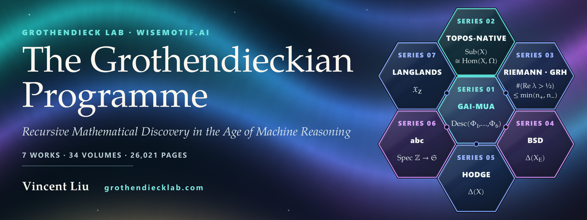

  

    

  <b><a href="https://grothendiecklab.com/">grothendiecklab.com</a></b> ·
  <a href="https://grothendiecklab.com/programme/">The Programme</a> ·
  <a href="https://grothendiecklab.com/method/">Method</a> ·
  <a href="https://grothendiecklab.com/machine/">Machine</a> ·
  <a href="https://grothendiecklab.com/open/">Open problems</a> ·
  <a href="https://grothendiecklab.com/lab/">The Lab</a> ·
  <a href="https://grothendiecklab.com/zh/">中文</a> ·
  <a href="https://wisemotif.ai">WiseMotif.ai</a>

**Grothendieck Lab · WiseMotif.ai.** The official site of Grothendieck Lab and of the Grothendieckian Programme.

<b>Grothendieck Lab</b> is the laboratory of WiseMotif.ai in which the Grothendieckian Programme is developed.

**Recursive mathematical discovery is recursive self-improvement, held to the standard of proof.**

This repository holds the built site only — static HTML, CSS, one script bundle, fonts and images — published by GitHub Pages at https://grothendiecklab.com. The sources of the site are not published. Corrections to the works: [the errata form of the Programme repository](https://github.com/AlienMuse/grothendieckian-programme/issues/new?template=errata.yml).

- The Programme: <https://github.com/AlienMuse/grothendieckian-programme> · DOI [10.5281/zenodo.23669107](https://doi.org/10.5281/zenodo.23669107)
- The 57 problems: <https://github.com/AlienMuse/grothendieckian-problems>
- Zenodo community: <https://zenodo.org/communities/grothendieckian-programme>

## Licence

The site's code: © 2026 Vincent Liu, all rights reserved. The site's own text: CC BY 4.0. Quotations from the works keep the works' licence, CC BY-NC-ND 4.0. See [LICENSE](LICENSE).

The site uses, under their own licences:

- Three.js: [MIT License](static/js/three-LICENSE.txt)
- TeX Gyre Pagella and TeX Gyre Pagella Math, as TGP Pagella: [GUST Font License](static/fonts/GUST-FONT-LICENSE.txt)
- STIX Two Math, as TGP Symbol Math: [SIL Open Font License 1.1](static/fonts/OFL-STIX-Two.txt)
- Selawik, as Lab Sans: [SIL Open Font License 1.1](static/fonts/OFL-Selawik.txt)

[The name](https://grothendiecklab.com/lab/#name) · © 2026 Vincent Liu · [ORCID 0009-0000-8718-222X](https://orcid.org/0009-0000-8718-222X)
